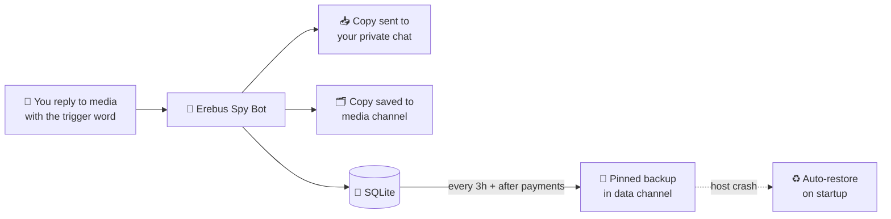

<div align="center">

# 👾 Erebus Spy Bot

### Archive any Telegram media in one reply. Premium, UPI payments, auto-backups.


[**@ErebusSpyBot**](https://t.me/ErebusSpyBot) · [**Developer**](https://t.me/Noxmirage) · [**Updates**](https://t.me/linksfromerebus) · [**Channel**](https://t.me/HazenNexus)

</div>

---

## ✨ Features

| | Feature | Details |
|---|---|---|
| 📸 | **Business archiving** | Reply to media with the trigger word (default `shit`) from your connected Business account |
| 🔐 | **Owner-only trigger** | Only the owner of a Business connection can trigger it; media goes only to that owner |
| ⚡ | **Daily limits** | 20/day free by default, custom limit per user, unlimited for premium |
| 💳 | **UPI payments** | Custom QR per plan with amount pre-filled, screenshot sent to admin with ✅ Approve / ❌ Reject |
| ⭐ | **Premium** | Plans from ₹29, stacks on top of remaining time, user notified instantly |
| 🛠 | **Admin panel** | Stats, users, premium list, broadcast, direct message, ban / unban |
| 🔒 | **Force-join** | Users must join your channel and group first |
| 🎨 | **Animated emojis** | Premium emoji IDs built in, coloured buttons with icons |
| 🧹 | **Self-cleaning chat** | Menus edit in place; prompts, QR images and commands delete themselves |
| 💾 | **Auto backups** | Database pinned in a private channel and auto-restored after a host crash |
| 🗂 | **Media vault** | Every archived file is copied to a private media channel |

---

## 🧭 How it works



### 👤 For users

1. Start the bot and join the channel and group
2. Connect the bot in **Settings → Business → Chatbots**
3. In any chat, **reply to a media message** with the trigger word
4. The copy arrives in your private chat with the bot

### 💳 Buying premium

1. Tap **Buy Premium** and choose a plan
2. Scan the QR with any UPI app and pay the exact amount
3. Tap **I've Paid** and send the screenshot
4. The admin approves and you get a confirmation message

| Plan | Validity | Price |
|:---:|:---:|:---:|
| 🥉 1 Month | 30 days | **₹29** |
| 🥈 2 Months | 60 days | **₹39** |
| 🥇 3 Months | 90 days | **₹49** |

---

## 📋 Requirements

> [!IMPORTANT]
> Connecting a bot as a chatbot needs **Telegram Premium** on the account that owns the Business connection.

- 🐍 Python **3.10+**
- 🤖 A bot token from [@BotFather](https://t.me/BotFather) with **Business Mode** enabled (Bot Settings → Business Mode)
- 👮 The bot added as **administrator** in your channel and group (needed to check membership)
- 📢 Two private channels with the bot as admin: one for media, one for database backups

---

## 🚀 Setup

```bash
git clone https://github.com/<your-username>/<your-repo>.git
cd <your-repo>

python -m venv venv
source venv/bin/activate        # Windows: venv\Scripts\activate

pip install -U "aiogram>=3.25" python-dotenv "qrcode[pil]"

cp .env.example .env            # then edit .env
python bot.py
```

### ⚙️ Configuration (`.env`)

```env
# --- required ---------------------------------------------------
BOT_TOKEN=123456:ABC-your-token
OWNER_ID=123456789

# --- membership gate -------------------------------------------
CHANNEL=@linksfromerebus
GROUP=@ecochamber

# --- limits & payments -----------------------------------------
FREE_DAILY_LIMIT=20
UPI_ID=yourname@upi
UPI_NAME=Erebus Premium

# --- private channels (numeric IDs, NOT invite links) ----------
MEDIA_CHAT_ID=-100xxxxxxxxxx      # copies of every archived file
BACKUP_CHAT_ID=-100yyyyyyyyyy     # database backups (pinned)
BACKUP_EVERY_HOURS=3

# --- optional ---------------------------------------------------
DB_PATH=bot_data.sqlite3
USE_CUSTOM_EMOJI=1
```

| Variable | Required | Default | Description |
|---|:---:|---|---|
| `BOT_TOKEN` | ✅ | n/a | Token from @BotFather |
| `OWNER_ID` | ✅ | n/a | Your numeric Telegram ID (admin) |
| `CHANNEL` | | `@linksfromerebus` | Channel users must join |
| `GROUP` | | `@ecochamber` | Group users must join |
| `DB_PATH` | | `bot_data.sqlite3` | Database file (use a persistent disk if your host has one) |
| `FREE_DAILY_LIMIT` | | `20` | Daily archives for free users |
| `UPI_ID` | | in code | UPI ID that receives payments |
| `UPI_NAME` | | `Erebus Premium` | Payee name shown in the UPI app |
| `MEDIA_CHAT_ID` | | off | Private channel for media copies |
| `BACKUP_CHAT_ID` | | owner's chat | Private channel for database backups |
| `BACKUP_EVERY_HOURS` | | `3` | Backup interval |
| `USE_CUSTOM_EMOJI` | | `1` | `0` switches animated emojis off |

> [!TIP]
> Invite links like `t.me/+abc...` cannot be used. Add the bot as admin, then forward a channel message to an ID bot (for example @getidsbot) to get the `-100…` number.

Plans are set near the top of `bot.py`:

```python
PLANS = {1: (30, 29), 2: (60, 39), 3: (90, 49)}   # months: (days, price in INR)
```

---

## 🛠 Commands

### 👤 Users

| Command | Action |
|---|---|
| `/start` | Open the main menu |
| `/cancel` | Cancel the current payment step |

### 👑 Admin (owner only)

Everything is also reachable from the **🛠 Admin Panel** button.

| Command | What it does |
|---|---|
| `/premium @user days` | Give premium for N days (user is notified) |
| `/removepremium @user` | Remove premium |
| `/setlimit @user number` | Custom daily limit for one user |
| `/setlimit @user default` | Reset to the default limit |
| `/userinfo @user` | Plan, usage, total archives, connections, last seen |
| `/msg @user text` | Message one user (an ID works too) |
| `/ban @user` · `/unban @user` | Block or unblock a user |
| `/backup` | Send a database backup now |
| `/restore` | Reply to a backup file to restore it |
| `/emojis` | List emoji names and their custom IDs |
| `/emojireset name` or `all` | Remove custom emoji overrides |

> [!NOTE]
> Users can only be found by `@username` after they have started the bot.

---

## 🎨 Interface

- 🧩 Panel-style screens: quote header, emoji rows, wide buttons, small-caps font
- 🌈 Coloured buttons (blue, green, red) and custom-emoji icons on `aiogram >= 3.25`
- ✨ Animated emoji IDs built in. To change one, send the bot `name` + a custom emoji (example: `star` + your emoji). IDs save to `emoji_ids.json`
- 🧯 If anything misbehaves, set `USE_CUSTOM_EMOJI=0`

---

## 💾 Backups & recovery

```diff
+ Database : compressed snapshot sent to BACKUP_CHAT_ID and pinned
+ Triggers : every BACKUP_EVERY_HOURS hours, after each approved payment, or /backup
+ Restore  : automatic on startup if the database file is missing, or /restore manually
+ Media    : every archived file is copied into MEDIA_CHAT_ID with owner, chat and time
- Not included : emoji_ids.json and the local saved_media/ folder
- Limit        : bots can download files up to 20 MB; data since the last backup is lost in a crash
```

---

## 🗄 Database

SQLite, created and migrated automatically on start. All timestamps are UTC and the daily limit resets at **00:00 UTC**.

| Table | Purpose |
|---|---|
| `users` | Everyone who started the bot, plus `custom_limit` and `banned` |
| `premium` | Premium expiry per user |
| `business_connections` | Connected Business accounts and their owners |
| `usage_daily` | Per-user, per-day counter used for limits |
| `archives` | History of every archived file |
| `payments` | Requests: pending / approved / rejected |
| `processed_messages` | Stops the same trigger being handled twice |
| `broadcasts` | Broadcast history |

---

## 📁 Project structure

```text
.
├── bot.py              # the whole bot
├── requirements.txt
├── .env.example
└── README.md
```

Created at runtime (keep out of Git): `.env`, `emoji_ids.json`, `bot_data.sqlite3`, `saved_media/`, `bot.log`

---

## 🩺 Troubleshooting

| Problem | Fix |
|---|---|
| Join check always fails | Make the bot an admin in both channel and group |
| Archive does nothing | Check the bot is under Settings → Business → Chatbots, the owner has started the bot, and the trigger word is exact |
| No QR code | `pip install "qrcode[pil]"` |
| Buttons without icons or colours | `pip install -U aiogram` |
| Backups or media not appearing | Use the numeric `-100…` ID and make the bot admin with post (and pin) rights; check `bot.log` |
| Emojis not animated | Telegram may not allow custom emojis for the bot; normal emojis are used instead |

---

## 🔒 Security & responsible use

> [!WARNING]
> **Never commit `.env`**, it holds your bot token. Payments are approved **manually**, so check each screenshot against your UPI app before tapping Approve. Only `OWNER_ID` can use admin buttons and commands.

This bot copies media from chats of connected Business accounts and keeps copies in your private channels. Tell users a backup copy is kept (the How To Archive screen does), restrict access to those channels, delete data on request, and follow Telegram's Terms of Service and the privacy laws that apply to you.

---

<div align="center">

### 👨‍💻 Credits

[**@Noxmirage**](https://t.me/Noxmirage) · [**@HazenNexus**](https://t.me/HazenNexus) · [**@linksfromerebus**](https://t.me/linksfromerebus)

Made with ❤️ for the Erebus community

</div>
